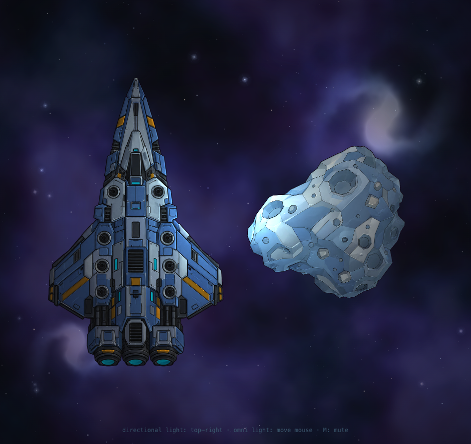

# SpacePewPew

**PixiJS v8 + Vite + TypeScript** starter with a procedural space background, a normal-mapped
lighting demo (ship + asteroid), **Howler** audio, and an agent-inspectable shared browser.
There is no gameplay loop yet — this is the foundation to build on.



## Quick start

```bash
pnpm install
pnpm dev
```

Open http://localhost:5173. Node **22.12+** and pnpm **10** are expected (`.nvmrc` pins Node 22).

## Stack

| Area      | Choice                                                                      |
| --------- | --------------------------------------------------------------------------- |
| Rendering | [PixiJS v8](https://pixijs.com/)                                            |
| Bundler   | [Vite 8](https://vite.dev/)                                                 |
| Language  | TypeScript 6 (strict)                                                       |
| Audio     | [Howler 2](https://howlerjs.com/) via a typed wrapper                       |
| Lighting  | Small custom GLSL Mesh shader (normal maps, directional key, emissive glow) |
| Tests     | Vitest                                                                      |
| Quality   | ESLint (flat config), Prettier, EditorConfig                                |
| Browser   | Playwright + Playwright MCP, shared via Chrome DevTools Protocol            |
| Package   | pnpm                                                                        |

## Scripts

| Command                             | What it does                                                         |
| ----------------------------------- | -------------------------------------------------------------------- |
| `pnpm dev`                          | Vite dev server with HMR on `http://localhost:5173`                  |
| `pnpm dev:bg`                       | Start a detached dev server (pid/log in `.agent/`)                   |
| `pnpm dev:status`                   | Show whether the detached dev server is running                      |
| `pnpm dev:stop`                     | Stop the detached dev server                                         |
| `pnpm build`                        | Typecheck and build to `dist/`                                       |
| `pnpm preview`                      | Serve the production build                                           |
| `pnpm typecheck`                    | `tsc --noEmit`                                                       |
| `pnpm lint` / `pnpm lint:fix`       | ESLint                                                               |
| `pnpm format` / `pnpm format:check` | Prettier                                                             |
| `pnpm test` / `pnpm test:watch`     | Vitest                                                               |
| `pnpm check`                        | Typecheck + lint + format check + tests + build (definition of done) |
| `pnpm browser:launch`               | Launch/reuse the shared Playwright-controlled Chrome                 |
| `pnpm browser:open`                 | Alias for `browser:launch`                                           |
| `pnpm browser:inspect`              | Screenshot + console/state dump (`--headless` for a throwaway run)   |
| `pnpm browser:act <action>`         | Drive the shared browser (click, type, eval, maximize, …)            |
| `pnpm browser:stop`                 | Close the shared browser                                             |
| `pnpm mcp:browser`                  | Run the Playwright MCP stdio server manually                         |

### Harness slash commands

In the DeepSeek Harness chat composer, type `/` (or click the composer's `+`) to see the
zero-token commands contributed by the desktop profile's `spacepewpew-commands` bundle:

- `/dev` — start/ensure the detached dev server (`pnpm dev:bg`),
- `/browser` — launch/reuse the shared Playwright Chrome.

Command handlers run in the Harness host process, outside the agent sandbox: no model turn, no
tokens, and Chrome keeps its own sandbox. The bundle lives in
`~/.dsh/profiles/desktop/spacepewpew-commands`; the equivalent terminal commands remain
`pnpm dev:bg` and `pnpm browser:launch`.

## Project layout

```
src/
  app/create-app.ts       PixiJS Application bootstrap
  app/lighting-scene.ts   Ship + asteroid lighting demo (keep small)
  app/ship-flight.ts      Pure ramped WASD flight model (tested)
  app/flight-tuner.ts     Live overlay sliders for flight tuning
  app/flight-telemetry.ts Read-only terminal/velocity/input telemetry overlay
  app/ground-grid.ts      Screen-space 1 m grid fixed to the near dust layer
  app/engine-exhaust.ts   Cone flames + world-space smoke exhaust
  app/engine-audio.ts     Per-engine hum loops driven by nozzle power (tested)
  app/engine-layout.ts    Shared main/reverse engine positions
  app/engine-mix.ts       Pure ramped engine-output mixer (tested)
  app/turrets.ts          Eight turret mounts with finite-speed mouse tracking
  app/turret-aim.ts       Pure angular aim physics (tested)
  app/weapons.ts          Per-pair weapon sound pools + committed shots + cadence
  app/weapon-mode.ts      Weapon systems (guns/mining), gun aim modes, control hint
  app/weapon-tuner.ts     Live rate-of-fire sliders
  app/mining.ts           Mining rig: red lasers, molten chunks, green tractors, cargo grill
  app/mining-model.ts     Pure reflection/ray-hit/tractor-drag math (tested)
  app/bullets.ts          Pooled 1 m glowing tracers (200 m range)
  app/bullet-math.ts      Bullet range/fade math (tested)
  app/world-scale.ts      Metres ↔ pixels conversion (64 px per metre)
  app/lit-sprite.ts       Custom normal-map Mesh shader (directional + emissive)
  app/background.ts       Layered procedural background (nebulas, galaxies, stars)
  app/background-textures.ts  One-time procedural canvas textures (nebula/galaxy/star/flare)
  app/starfield-model.ts  Deterministic star generation + projection (tested)
  audio/audio.ts          Howler wrapper: load, play, mute, unlock, per-shot rate/pan
  utils/                  Small pure helpers (tested)
  main.ts                 Entry point, HMR cleanup, inspection hook
public/
  favicon.svg
  audio/weapons/          Processed weapon SFX (1 beam + 3 charge-blasts)
  audio/engines/          Seamless engine loops (hums + speed rush + retro strain)
  assets/lighting/        Processed color/normal maps + ship emissive/glow maps
scripts/
  browser.mjs             Shared-browser CLI (open / inspect / act / stop)
  mcp-browser.mjs         Playwright MCP launcher (attaches to shared browser)
  lib/shared-browser.mjs  CDP/browser lifecycle helpers
tests/                    Vitest unit tests
docs/                     Architecture decisions, reference art and agent workflow
.agent/                   Generated browser artifacts and profile (gitignored)
```

## Controls

- **W/S** thrust forward/back; **A/D** rotate. Inputs ramp in over 0.3 s. Drag applies to both
  linear and angular motion whenever any input is active; **thrust vs drag decide terminal
  speeds** — no separate speed cap.
- The ship flies on the **near dust layer**; the camera smoothly pans with it. Lookahead grows
  **quadratically with speed** (near zero at low speed, full near terminal) and increases when
  zoomed out, so at speed the ship sits behind centre in its travel direction. The asteroid is
  fixed on that layer, and the layer is rigid.
- A subtle cyan **ground grid** is fixed to that layer: minor cells are **1 m × 1 m** (64 world
  px per metre), major lines every 5 m. Ship movement and speed read against it.
- Parallax is logical: pan is integrated from camera motion for every layer, so the near
  dust/grid layer always moves fastest and each farther layer moves proportionally less. Wheel
  zoom only scales layers about the viewport centre, so zooming never slides the sky after a
  long flight. The two distant galaxies are fixed to the sky.
- The top-left **FLIGHT TUNING** panel has live sliders for thrust (0–60 m/s² forward, 0–45 reverse), torque (0–40 rad/s²),
  linear/angular drag and input ramp. The top-right **FLIGHT TELEMETRY** panel shows terminal W/S/A-D speeds,
  current velocity, angular velocity, and ramped inputs (all linear units in metres). The
  bottom-left **RATE OF FIRE** panel tunes the cooldown of each weapon pair, clamped to the
  pair's charge duration.
- Eight turrets with finite angular speed and limited cones: front pair forward, middle four sideways, rear pair side-to-rear. Targets outside a cone are ignored, so that turret holds its current aim instead of sweeping along the boundary.
- **Tab** switches the weapon system: the **gun battery** or the **mining rig**. **1 / 2** pick how the guns aim. **1** (default) tracks the mouse. **2** parks every mount at the forward-most aim its own cone permits — front turrets dead ahead, middle pairs 45° off the nose, rear pairs broadside — so the whole battery points as far forward as the hull allows.
- **Scroll** zooms out from the default 1× (`0.02×–1×`, 50× max zoom-out).
  Camera dragging and click-to-reset are intentionally disabled. Audio is tied to the shot: 1× is
  full volume and the 50× zoom-out limit fades everything to about 20% (≈ −14 dB), so pulling
  the camera back feels farther away.
- **Guns (Tab), mouse aim (1): click / hold** fires the pair(s) aimed at the mouse. **Guns, forward aim (2): hold Space** fires all four pairs from every barrel. Each pair still respects its own rate of fire. The front pair uses the beam, rear pairs alternate blast variants with randomized pitch, volume, and stereo pan (keyboard shots stay centred). Rounds are 1 m glowing tracers aligned with the barrel that inherit ship momentum, travel 200 m, and fade over the last 50 m. Firing starts the weapon's charge sound; the tracer is scheduled for the measured blast impact, so the visual shot lands with the audio, and a shot committed inside a cone still leaves the barrel if the mouse leaves before the charge ends. Rear-pair barrel tips glow cyan when charged, intensify while their charge sound plays, then extinguish at the shot until that pair recharges. The front beam keeps the normal charged/empty state. **M** mutes/unmutes.
- **Mining rig (Tab): hold click** fires the front pair as **red mining lasers**, mouse-aimed like gun mode 1. A laser that bites the asteroid melts off a small **solid metal chunk** — a square, rectangle or triangle with a heat-shaded body and a baked glow halo — which drifts away along the laser's **reflection angle** at 1.2–2.8 m/s, slowing as it cools. The six rear/middle barrels become **green tractor beams** with a short **5 m reach**; they run autonomously and **swing fully round** (no cone limit) to point at the chunk each one is holding. At most **six chunks move at once** (one per tractor barrel): a beam keeps the chunk it grips until delivery, and a _free_ beam claims the **most external** chunk in reach first — the freshest metal, most likely to drift off. Beams never steal a chunk another beam already holds; spare beams stay idle rather than piling onto the same object. If a chunk swings faster than its barrel can slew (over 3 rad/s required), the beam **drops** it so another tractor can pick it up. Tractor barrels also slew faster than the guns, and a chunk is only reeled in once its beam is actually connected (barrel within ~13°) — until then it keeps drifting and no beam is drawn, so cargo never slides toward the ship ahead of its beam. Carrying moves **in the ship's frame**, so a flying ship never outruns its cargo; a chunk that drifts beyond 5 m of its beam is dropped and drifts freely, and loose metal cools, slows and fades after ~8 s. **P** toggles the carry model: **curved** (default — the chunk **arcs** to the hatch, turning no faster than a tractor barrel can slew so the beam can follow it) or **physics** (bounded acceleration, momentum). The bottom hint shows `carry:`. Delivered chunks increment **cargo**, shown in the bottom hint.

## Lighting

Lighting is a small custom GLSL Mesh shader ([src/app/lit-sprite.ts](src/app/lit-sprite.ts)) —
no external lighting package:

- one **directional key light from the top-right** plus ambient fill,
- tangent-space **normals rotated by each mesh's rotation**, so spinning ships shade correctly,
- lit textures **auto-generate mipmaps (texture LOD)**, so zooming far out doesn't shimmer; MSAA
  stays on for geometry edges,
- the ship's cyan panels use baked **emissive + blurred glow** maps with a subtle pulse,
- the ship runtime texture is **mirrored across the vertical axis** (the source AI art was not
  symmetrical); rear cyan engine ovals are excluded from the emissive layer for later special
  treatment,
- the pointer omni light was removed after testing.

It is WebGL-only, so `create-app.ts` pins `preference: 'webgl'`. The reference art already has
baked cel shading, so normals are kept at 0.30 strength to avoid a metallic/embossed look.

## Reference art

Source art for the 2.5D game (ship + asteroid, color/key and matching normal maps) lives in
[docs/reference/](docs/reference/) — see [REFERENCE_ART.md](docs/REFERENCE_ART.md). Processed
runtime copies live in [public/assets/lighting/](public/assets/lighting/).

## Audio

Howler is wired through `src/audio/audio.ts`. The four committed weapon clips in
`public/audio/weapons/` were split, faded, and normalized from the supplied sources:

- `beam-front.wav` — front pair,
- `blast-3.wav` — 2nd pair,
- `blast-4.wav` — 3rd pair,
- `blast-5.wav` — rear pair.

For the three rear weapons, only the pre-blast charge was time-compressed to ~300 ms and
equal-power crossfaded into the untouched blast body (no hard cuts). Clicking starts the charge;
`WEAPON_SHOT_DELAYS` holds the tracer until the measured blast impact. The 1st/2nd sequence
sounds are not used as weapon shots.

Each pair cycles its pool without repeating the previous shot, and every shot gets small
playback-rate, volume, and stereo-pan variation. Keep clips small and avoid build-time asset
pipelines.

### Engine hums

Every nozzle owns a continuous hum voice (`src/app/engine-audio.ts`) whose gain follows that
engine's ramped power from `computeEngineOutputs`: the centre main engine gets the heavy
body, the two side main engines a normal mid layer, and the two reverse engines a lighter,
higher layer. The loops are voiced like **electric turbines**, not combustion rumbles: a
smooth low body, a sparse harmonic spine with random phases, and a clean slot-whine cluster
(roughly 1.2–4.3 kHz) with a very slow shimmer. There is no saturation and only a low, smooth
noise bed, so nothing intermodulates into buzz. Each voice gets a small left/right detune, a
pitch rise with power **and speed** (+3% / +8% at forward terminal), a speed-coupled gain lift,
and stereo pan from the nozzle's screen position, so turning reads through the audio as well
as the exhaust. At zero thrust the loops run silently; the first pointer/key gesture unlocks
them along with the weapon SFX.

On top of the per-nozzle hums sit two shared layers:

- a **speed rush** that swells with speed (roughly `speedFraction^1.35`, up to 0.85 gain at
  forward terminal speed) and rises from `0.9×` to `1.1×` rate with it, so acceleration ramps
  audibly — and urgently — up to terminal,
- a **retro strain** bed that fades in when an engine's thrust opposes the ship's velocity — the
  dot product of thrust and velocity is negative. The normal hum ducks as the strain comes in,
  so firing the main engines while flying backwards sounds laboured rather than clean. Reverse
  engines get the mirrored case (braking a forward run with S).

All five seamless loops in `public/audio/engines/` are generated offline: tonal layers and LFOs
are quantised to integer cycles per loop and the noise beds are synthesised in the frequency
domain with random phases, so the loop point is mathematically seamless (no fades, no hard
cut). Runtime rate changes are safe because the loop length is unchanged.

Camera distance is part of the mix: `listenerGainForZoom()` drives Howler's master gain (1× =
full, ~0.20 at the 50× zoom-out limit), so engine hums, the speed rush, braking strain and
weapon shots all fade together as the camera pulls out. Zoom is already eased, so the fade is
smooth and mute/unmute restores the current distance level.

## Agentic development

This repo is set up for coding agents:

- **[AGENTS.md](AGENTS.md)** — the rules and workflow every agent should follow, read natively by
  Claude Code and DeepSeek Harness.
- **[docs/AGENT_WORKFLOW.md](docs/AGENT_WORKFLOW.md)** — how the shared browser and Playwright MCP work.
- **[docs/DECISIONS.md](docs/DECISIONS.md)** — short architecture decision log.
- The shared Chrome window is the same page the human sees: both can interact with it live.
- Playwright MCP is configured in the DSH desktop profile and attaches to that shared browser
  when it is running. MCP tools (`mcp__playwright__*`) require a DSH restart after profile
  changes.
- CLI flags, environment variables, MCP configuration and artifacts are documented in
  [docs/AGENT_WORKFLOW.md](docs/AGENT_WORKFLOW.md).

## Browser sandbox note

The shared browser is launched once **outside** the agent sandbox so Chrome keeps its own
sandbox. Later sessions and agents only attach over CDP. The tooling never disables Chrome's
sandbox by default; `SPACEPEWPEW_CHROME_NO_SANDBOX=1` is an explicit escape hatch for
disposable CI environments. If the browser is closed, relaunch it once from a normal terminal
(or approve the one-time elevated run) — do not cargo-cult sandbox-disabling flags.
