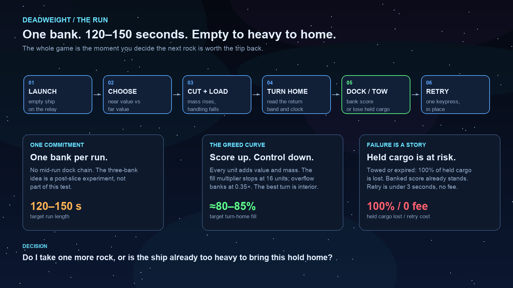
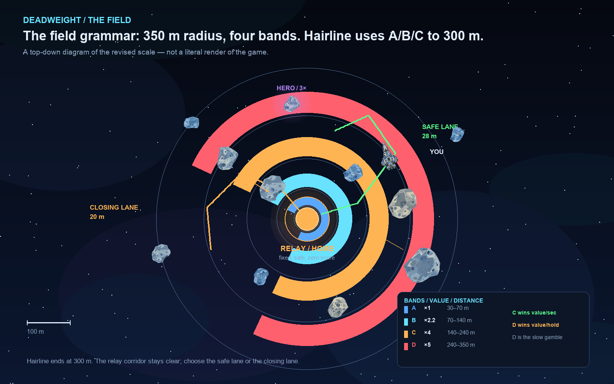
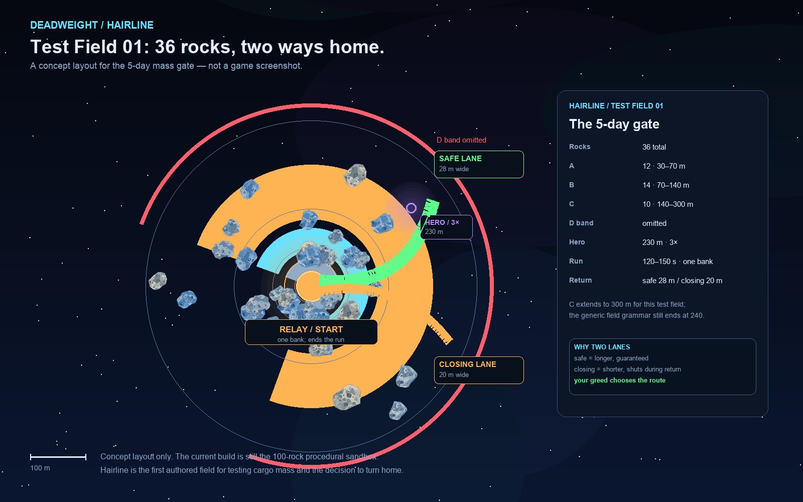
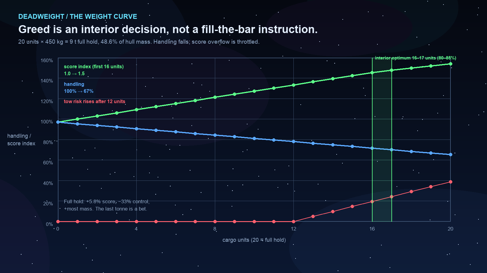
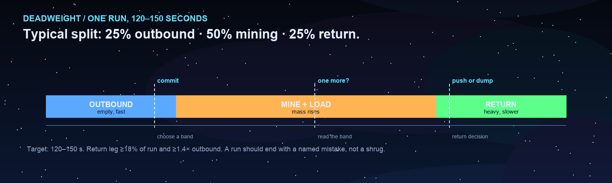
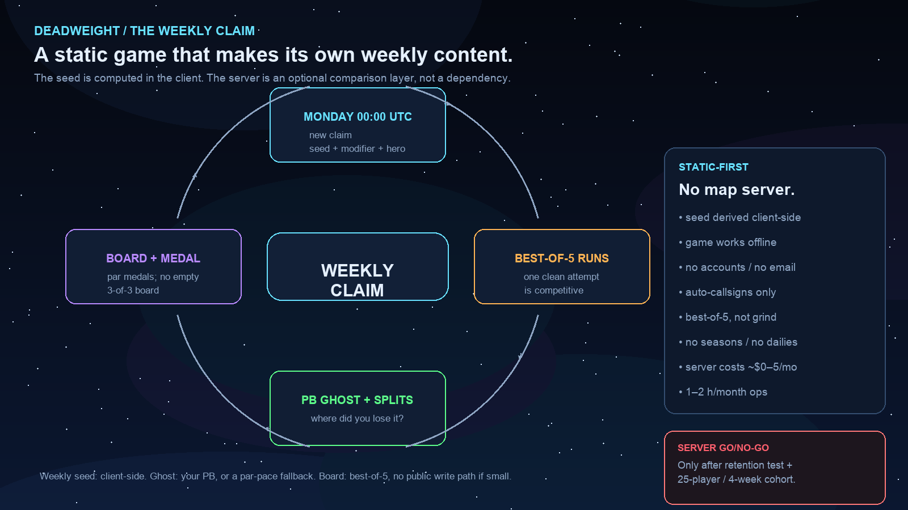
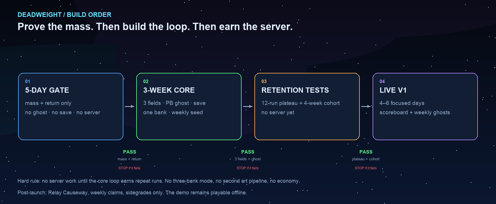
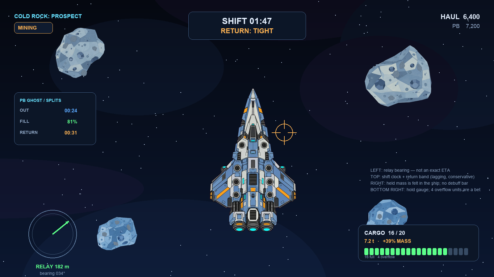

# DEADWEIGHT — visual companion

These are **diagrams, not in-game screenshots**. They exist to make the brief easier to see at a
glance. The written decision record is [DEADWEIGHT.md](DEADWEIGHT.md).

---

## 1. The run



One bank, 120–150 seconds, empty ship → heavy ship → home. The run is a single commitment: there is
no mid-run bank chain in this build. Every extra chunk is score and mass; the return band is the
readout that turns “how much longer?” into a judgement call.

---

## 2. The field



A top-down view of the revised scale: **350 m radius**, four bands. **Hairline** — the 5-day gate
field — uses A/B/C out to 300 m.

- **A** 30–70 m · ×1
- **B** 70–140 m · ×2.2
- **C** 140–240 m · ×4 — value/second band
- **D** 240–350 m · ×5 — slow, high-score gamble
- The relay is fixed and safe. The return is never a pure mirror of the outbound leg.
- Two ways home: a long safe lane and a shorter closing lane.
- Cutting destabilises a neighbouring rock. Drift is deterministic and recorded in the ghost.

### Hairline / Test Field 01



This is the first authored field for the 5-day gate — the layout behind the name “Hairline”.

- **36 rocks:** A 12 · B 14 · C 10.
- **No D band.** C is extended to **300 m** for this test field.
- **Hero rock at 230 m.**
- Two ways home: a **28 m safe lane** and a **20 m closing lane**.
- One bank, 120–150 s; the run ends on dock, expiry or tow.
- Concept only: the current build is still the 100-rock procedural sandbox.

---

## 3. The weight curve



**20 cargo units × 450 kg = 9 t full hold**, which is **48.6% of the 18.5 t hull mass**. Empty
terminal speed is ~18 m/s; full hold is ~12 m/s. Handling falls ~33%.

The fill multiplier rises to ×1.5 at 16 units; units 17–20 bank at 0.35×. That makes the rational
turn-home land around **80–85% full**, not 100%. A full hold is only **+5.8% score** for the last
four units — but it adds the most mass and tow risk. That is the bet.

Score expression:

```text
score = (1 + 0.5 × min(units, 16)/16) × value(first 16 units)
      + 0.35 × value(units 17–20)
```

---

## 4. The run timeline



A typical split: **25% outbound · 50% mining · 25% return**. The return leg must be at least **18%**
of the run and at least **1.4×** the outbound leg. If the trip home is a straight reversal, the
concept is not working.

---

## 5. The weekly live layer



The client derives the weekly seed. The server is an optional comparison layer, not a dependency.

- Reset Monday 00:00 UTC.
- Best single run, up to five attempts.
- PB ghost + split ledger; par medals; no empty “rank 3 of 3.”
- No seasons, no dailies, no accounts.
- Server only after retention tests + a 25-player/4-week closed cohort.

---

## 6. Build order



**5-day feel gate → 3-week core → retention tests → 4–6 day live v1.**

No server before retention. No economy before the mass loop is proven. No three-bank mode before
the one-bank run works.

---

## 7. HUD concept



A mood/readability mock, not a final UI:

- **Top:** shift clock + return band (`TIGHT`) — no exact seconds.
- **Left:** PB split ledger.
- **Bottom-left:** relay bearing and distance.
- **Bottom-right:** hold gauge; 16 full units + 4 overflow units shown.
- **No mass/debuff bar.** The ship’s handling, engine note and camera carry the weight.

---

## The one-page mental model

```text
EMPTY SHIP
   ↓  cut / tractor / cargo
HEAVY SHIP  ──  every unit is score + mass + tow risk
   ↓  read the return band
TURN HOME   ──  safe lane or closing lane
   ↓
DOCK (bank score)  or  TOW (lose 100% of held cargo)
   ↓
RETRY in <3 s  →  chase PB / weekly claim
```

The game is not “fill the bar.” It is **“how much value can I carry and still be the pilot who gets
home?”**
