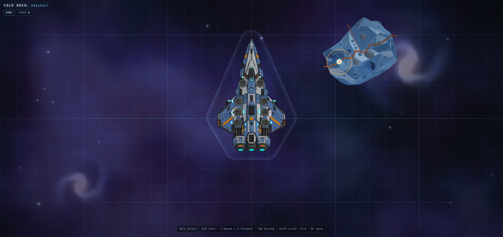
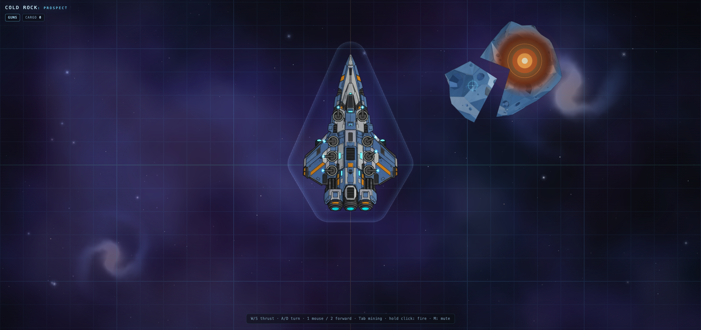
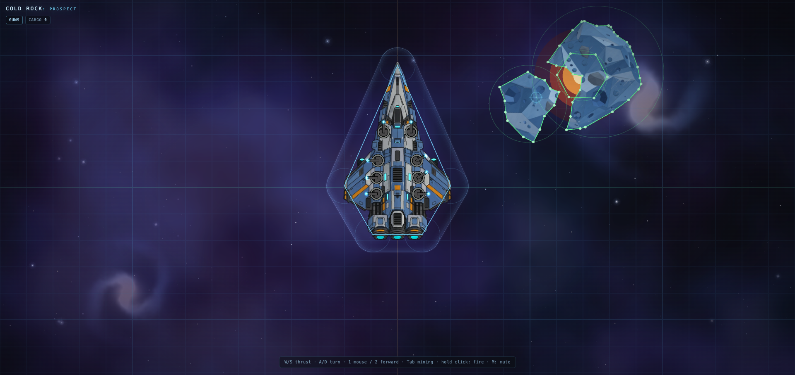
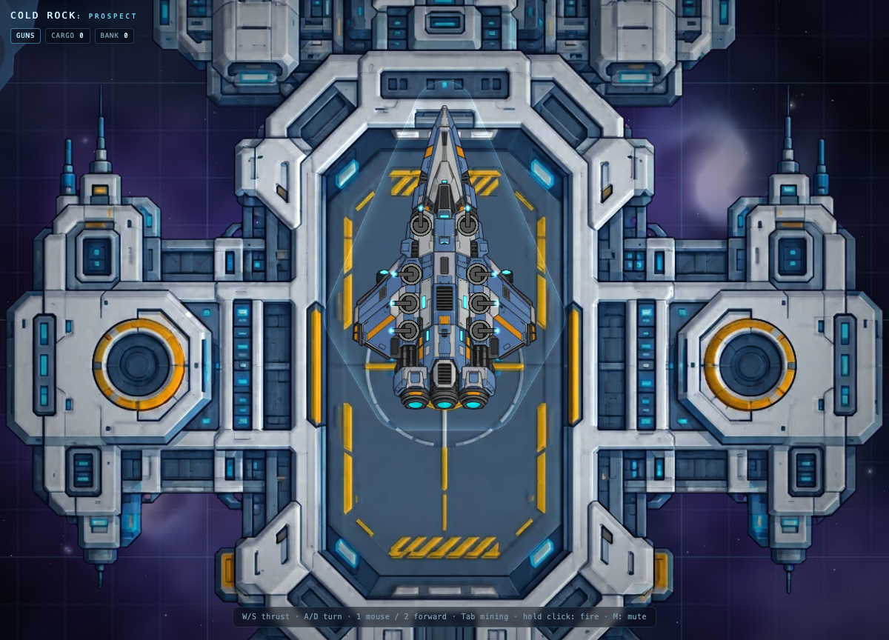

# Gameplay & systems deep dive

This is the detailed reference for what COLD ROCK: PROSPECT actually simulates: flight,
collisions, asteroids, weapons, mining, lighting and audio. For the short pitch,
quick start and controls see the [README](../README.md); for the architecture map
and agent workflow see [AGENTS.md](../AGENTS.md).

## Controls

Keyboard/mouse, a standard twin-stick gamepad and a two-stick touch layout all feed the same
input snapshot. Sticks are analog: their partial thrust/turn targets still pass through the
flight model's 0.3 s input ramp, so the ship eases in exactly as it does from keys. The right
stick becomes an aim direction that is projected into turret screen space; fire, stabiliser,
weapon switching, carry mode, zoom and mute are actions rather than raw key codes.

Mining lasers now run on **per-barrel heat**. A barrel fires for five seconds, vents quickly if the
trigger is released early, and locks into a slow cool-down if it overheats; the two HUD bars show
each barrel. Two beams focused on the same small spot melt 1.5× faster, and heat raises the laser
pitch. In the last 10% of the heat bar the beam visibly loses stability: its thickness chatters,
and an outer bloom flickers before lockout. The rig melts faster overall to compensate for the new duty cycle. A pressure-valve clack starts a short steam release at lockout; after roughly 1.5 seconds the
steam ends and the rest of the cool-down is carried by small contracting-metal ticks following the
falling heat bar. An early release never triggers steam — it ticks only. A short mechanical relay
tick marks re-arm when the barrel reaches zero heat. The laser
loop itself is a deeper, grittier cutter rather than a high sci-fi whine.

`1` / `2` select **mouse** or **forward** aim. Guns and mining lasers remember separate modes:
switching to the mining rig keeps its own mouse/forward choice, so 2 can park the cutting lasers
straight ahead while the gun battery stays on pointer tracking (and vice versa). Gamepad D-pad
←/→ and the touch **AIM** button switch the active weapon's mode.

- **X (hold)** fires the stabiliser: it cancels spin with a balanced yaw couple and brakes
  translation along the **current heading** with the applicable thruster — it never turns the
  ship toward a new direction. Sideways drift is handled by the linear drag that stabilising
  also engages.
- **W/S** thrust forward/back; **A/D** rotate. The ship is a rigid body: each nozzle pushes a
  force at its real position, and the engine mix (W/S plus A/D) decides each nozzle's output.
  Turning is therefore real **differential thrust** torque, not a scripted spin. Inputs ramp in
  over 0.3 s. Drag applies to both linear and angular motion whenever any input is active;
  **thrust vs drag decide terminal speeds** — no separate speed cap. Mass and inertia come from
  the hull, so a heavier ship accelerates and turns more slowly for the same thrust. The A/D
  couple is force-balanced: the main engine on the inside of the turn is throttled down to the
  reverse engine's thrust, so turns stay pure even when the reverse engines are weaker — yaw
  authority then equals the weaker thruster pair (shown as terminal yaw).
- The ship flies on the **near dust layer**; the camera smoothly pans with it. Lookahead grows
  **quadratically with speed** (near zero at low speed, full near terminal) as a fixed
  **world-space offset**, so at speed the ship sits behind centre in its travel direction. It is
  deliberately independent of zoom: otherwise every wheel notch would move the camera and slide
  the near dust/grid layer (the old parallax pan bug). The asteroid is
  fixed on that layer, and the layer is rigid.
- A subtle cyan **ground grid** is fixed to that layer: minor cells are **1 m × 1 m** (64 world
  px per metre), major lines every 5 m. It is drawn as a world-space mesh (a camera-centred quad
  transformed by the same camera as the dust/asteroid layer), so zooming pivots on the camera
  point and the grid can never drift from the world. For orientation the **x = 0 axis is amber**
  and the **y = 0 axis is green**. Ship movement and speed read against it.
- Parallax is logical: pan is integrated from camera motion for every layer, so the near
  dust/grid layer always moves fastest and each farther layer moves proportionally less. Wheel
  zoom only scales layers about the viewport centre, so zooming never slides the sky after a
  long flight. The two distant galaxies are fixed to the sky.
- The top-left **FLIGHT TUNING** panel has live sliders for ship mass (6–60 t), main and reverse
  engine thrust (10–500 kN each), linear/angular drag and input ramp. The top-right **TELEMETRY**
  panel shows mass, terminal W/S/yaw, current velocity, **G force and peak G** (real frame-to-frame
  acceleration, so impacts spike it), **cargo held**, **shield damage absorbed** (cumulative
  impact energy), angular velocity, ramped inputs and the drag rates currently in effect (zero
  while coasting). The
  bottom-left **RATE OF FIRE** panel tunes projectile speed (15–180 m/s) and the cooldown of each
  weapon pair, clamped to the
  pair's charge duration. **Tab to the mining rig** and the same panel swaps to **MINING
  TUNING**: melt dwell/spot/cool time, chunk eject speed/damping/lifetime, tractor reach and
  slew limit, cargo speed/turn/easing and laser range — all applied live.
- Eight turrets with finite angular speed and limited cones: front pair forward, middle four sideways, rear pair side-to-rear. Targets outside a cone are ignored, so that turret holds its current aim instead of sweeping along the boundary.
- **Tab** switches the weapon system: the **gun battery** or the **mining rig**. **1 / 2** pick how the guns aim. **1** (default) tracks the mouse. **2** parks every mount at the forward-most aim its own cone permits — front turrets dead ahead, middle pairs 45° off the nose, rear pairs broadside — so the whole battery points as far forward as the hull allows.
- **Scroll** zooms out from the default 1× (`0.02×–1×`, 50× max zoom-out).
  Camera dragging and click-to-reset are intentionally disabled. Audio is tied to the shot: 1× is
  full volume and the 50× zoom-out limit fades everything to about 20% (≈ −14 dB), so pulling
  the camera back feels farther away.
- **Guns (Tab), mouse aim (1): click / hold** fires the pair(s) aimed at the mouse. **Guns, forward aim (2): click / hold** fires the battery along the nose. **Space** is reserved for docking/undocking. Each pair still respects its own rate of fire. The front pair uses the beam, rear pairs alternate blast variants with randomized pitch, volume, and stereo pan (keyboard shots stay centred). Rounds are 1 m glowing tracers aligned with the barrel that inherit ship momentum, travel 200 m, and fade over the last 50 m. Firing starts the weapon's charge sound; the tracer is scheduled for the measured blast impact, so the visual shot lands with the audio, and a shot committed inside a cone still leaves the barrel if the mouse leaves before the charge ends. Rear-pair barrel tips glow cyan when charged, intensify while their charge sound plays, then extinguish at the shot until that pair recharges. The front beam keeps the normal charged/empty state. **M** mutes/unmutes.
- **Mining rig (Tab): hold click** fires the front pair as **red mining lasers**, mouse-aimed like gun mode 1. A laser that bites the asteroid **has to dwell on one spot**: the beam heats that spot for **~1.1 s**, burning an **orange melt patch** into the rock (the patch is attached to the asteroid's spinning surface, so it turns with the art). Sweeping the beam to another spot resets the heat. When the patch is fully melted it **spawns a solid metal chunk** — a flat **grey-blue** square or triangle with a thin rim — which drifts away along the laser's reflection angle at 1.2–2.8 m/s, slowing as it cools. The six rear/middle barrels become **green tractor beams** with a short **5 m reach**; they run autonomously and **swing fully round** (no cone limit) to point at the chunk each one is holding. At most **six chunks move at once** (one per tractor barrel): a beam keeps the chunk it grips until delivery, and a _free_ beam claims the **most external** chunk in reach first — the freshest metal, most likely to drift off. Beams never steal a chunk another beam already holds; spare beams stay idle rather than piling onto the same object. A chunk with a visually connected tractor beam is outlined in green with a small pulsing green halo, so cargo in transit reads differently from loose metal; a barrel that has claimed a chunk but is still swinging onto it shows nothing. If a chunk swings faster than its barrel can slew (over 3 rad/s required), the beam **drops** it so another tractor can pick it up. Tractor barrels also slew faster than the guns, and a chunk is only reeled in once its beam is actually connected (barrel within ~13°) — until then it keeps drifting and no beam is drawn, so cargo never slides toward the ship ahead of its beam. Carrying moves **in the ship's frame**, so a flying ship never outruns its cargo; a chunk that drifts beyond 5 m of its beam is dropped and drifts freely, and loose metal cools, slows and fades after ~8 s — but a chunk a tractor is gripping is cargo in transit, so its lifetime is **reset every frame** and it cannot vanish between the beam and the hatch. While mining, the barrel-tip glows change colour to match the rig: **red** on the front laser pair, **green** on the six tractors. They never vanish; each one **brightens and grows while its beam is live** and drops back to its normal glow when the beam stops. Mining glows are composited to read their true colour — a neutral white glow texture with normal blending — because additive red/green over the blue hull washes out to cyan; the two laser muzzles glow hotter, **1.3× larger** than the tractor barrels (alpha 0.9 idle, 1.0 while firing). Gun-mode glows come back when you Tab out. The **cargo hatch** — the hull's slatted vent between the rear pairs — pulses three glowing **rounded-rectangle rings** while the rig is equipped: each ring is the shape of the hatch outline, spawns at **1.2×** its size and **scales down through it**, brightening as it closes — the movie space-elevator pulling-in look. The rings quicken and brighten while cargo is inbound and flare when a chunk lands. Any chunk that drifts into the hatch — **tractored or not** — does not snap away: it **sinks into the hatch and scales to nothing** over ~0.3 s before its cargo count ticks up, so stray metal is swallowed without waiting for a beam.

**P** toggles the carry model: **physics** (default — bounded acceleration/momentum) or **curved** (the chunk **arcs** to the hatch, turning no faster than a tractor barrel can slew so the beam can follow it). The bottom hint shows `carry:`. Delivered chunks increment **cargo**, shown in the bottom hint.

**Asteroids live in the world**, in the same dust layer the ship flies through, so they pan and zoom with the environment; they tumble slowly (0.02–0.06 rad/s) rather than spin. The ship's **centre of mass and the camera start at the world origin**, and the field is a **deterministic scatter of 100 rocks** (seeded) around that origin — here and there, drawn from **ten art variants** (the two supplied rocks plus eight Blender-rendered ones), mostly normal sizes with a few 3x heroes. Placement keeps the **vertical grid axis clear** (no rock edge crosses x = 0) and the ship's spawn bubble empty. Adding more is a single `add(x, y, diameter, variant?)` on the field; every rock gets a collider traced from its own art — a bounding circle for the fast pass and a **convex silhouette polygon that turns with the rock** for the accurate pass — stops tracers, and can be mined (lasers bite the nearest rock their beam hits, tested against that polygon).

**Crackable test rock (prototype).** One authored rock sits ahead-right of the spawn. It starts
with a **single black jagged crack** clipped to the exact rock silhouette; that black line is the
shooting hitbox — **all five hits go into that first crack only**. Two hits turn it **black →
orange**. A **second crack** then emerges from the centre and grows outward toward the edge over
the remaining three hits, starting with little/no colour and ending orange. When both cracks are
fully orange on the fifth hit, the rock splits along the same **jagged polyline** into a **small
cracked-out piece** and a **larger >180° piece**. Both are baked from the original art, have their own polygon
colliders, drift only a short distance apart with an **immediate gap** and **persist** — no
physics engine. The
**molten core sits beneath the shell at the break seam**, exposed through that gap rather than
painted on the rock surface, and moves with the larger piece. Tab to the mining rig and cut it
like any other rock. The
shell must be opened with guns first: the mining rig has no target on the intact shell.

Press **F2** to see the broken fragment colliders and the exposed core included in the collider
gizmo.

**Dock.** The ship starts on the authored station pad. Fly back within **4.5 m** of the pad
centre and below **2 m/s** and held **CARGO** is transferred into **BANK**; the pad pulses and the
HUD bank counter rises. The dock is a visual launch/return platform — it has no collision hull.
With **F1** / `?dev=1`, the **DOCK PLACEMENT** panel exposes live **Dock X**, **Dock Y** and
**Dock scale** sliders so the station can be seated against the ship without editing code. The
current defaults are **X 0 m, Y −2 m, scale 33 m**.

Docking is a real state, not just proximity. The ship starts **DOCKED**, is flight-locked, and
the HUD shows a `DOCKED` pill. Press **Space** to undock; the pill switches to `FLIGHT` and the
ship begins to fly. After leaving the **9 m approach radius**, coming back opens the **DOCKING
ALIGNMENT** panel with position, heading and speed bars. To dock, all three must be inside their
thresholds — **1.5 m**, **10°** and **stationary (≤ 0.15 m/s)** — then press **Space** again;
docking is never automatic. The pill changes to `DOCKING` during the approach and returns to
`DOCKED` once captured.

With no Z axis, scale carries the height cue. The ship is drawn at **0.86×** while docked (lower
in the pad) and grows back to **1×** as it rises on undock. The station is full-size when docked
and recedes to about **0.68×** at the outer approach edge, then grows back as the ship lines up
to land. The fake ship shadow is attached to the ship, so it flies with it; it tightens under the hull when
docked, then slides down-right, spreads and fades as the ship gains altitude.

**The asteroid is solid.** A collider **gizmo** is hidden by default; press **F2** to overlay it while tuning (green = rock silhouettes and bounding circles, cyan = ship hull bubble). The ship carries a hull-shaped **energy shield** that is both its collision shape and its visual: its outline follows the hull — pointed nose, wing tips, blunt tail — as a convex outline inflated by a bubble radius of 16 % of the hull width (equivalently, capsule segments joined with rounded corners), so the whole ship sits inside it with room over the pointed nose and wing corners. The boundary glows and fades inward, so the edge reads as a surface. At rest the shield is
**dim**; a recent hit lifts the whole bubble to its full brightness and it eases back to rest
over ~2 s, so impacts read as the shield reacting rather than a permanently lit dome. Collisions are **impulse-based with weight**: the ship carries its flight-model **mass** (18.5 t by default) and a moment of inertia from its hull, the shield surface has **22% restitution** and a **0.5 friction** coefficient, and the impact is applied at the contact patch — so a nose or wing hit **spins the hull about its centre of mass**, glancing hits scrape and slow it, and head-on hits thud with a **camera shake** scaled by hit energy. An impact highlights the **contact patch** (a bloom at the point the rock touched, fading over ~0.3 s) **clipped to the shield**, so it brightens the bubble without spilling into space. Gun tracers are **stopped by the rock's silhouette** — a swept test means fast rounds cannot tunnel through it. Rock collision is a **two-stage compound polygon collider**: a bounding circle rejects almost everything cheaply, then a separating-axis test runs against **fan triangles covering the rock's low-poly contour** — traced ray-by-ray from the art alpha (128 subpixel samples) and simplified to a **32-vertex budget** (24–28 points per rock, ~1–2 % of radius) so the shape follows the real facets without paying for anti-aliasing detail, rotating with the rock's spin, so notches and bites are respected instead of being bridged by a convex hull. No physics engine is involved; the flight model stays authoritative. The contact solver only returns a physical impulse and angular impulse — the scene applies them through `applyShipImpulse()` on the flight body, so impacts always obey the configured mass and inertia instead of the collision code overwriting velocities.

The ship turns about a **physics centre of mass at the orange panel just behind the cargo hatch**, not its geometric centre: the hull's visual centre orbits the pivot, so hard turns swing the nose wide instead of rotating about the middle of the ship.

## Lighting

Lighting is a small custom GLSL Mesh shader ([src/app/lit-sprite.ts](../src/app/lit-sprite.ts)) —
no external lighting package:

- one **directional key light from the top-right** plus ambient fill,
- tangent-space **normals rotated by each mesh's rotation**, so spinning ships shade correctly,
- lit textures **auto-generate mipmaps (texture LOD)**, so zooming far out doesn't shimmer; MSAA
  stays on for geometry edges,
- the ship's cyan panels use baked **emissive + blurred glow** maps with a subtle pulse,
- the ship runtime texture is **mirrored across the vertical axis** (the source AI art was not
  symmetrical); rear cyan engine ovals are excluded from the emissive layer for later special
  treatment,
- the pointer omni light was removed after testing.

It is WebGL-only, so `create-app.ts` pins `preference: 'webgl'`. The reference art already has
baked cel shading, so normals are kept at 0.30 strength to avoid a metallic/embossed look.

## Reference art

Source art for the 2.5D game (ship + asteroid, color/key and matching normal maps) lives in
[docs/reference/](reference/) — see [REFERENCE_ART.md](REFERENCE_ART.md). Processed
runtime copies live in [public/assets/lighting/](../public/assets/lighting/).

## Asteroid art

The two supplied rocks are joined by **eight Blender-rendered variants** in
[public/assets/lighting/generated/](../public/assets/lighting/generated/) (committed WebP: colour +
camera-space normal per variant). They were baked offline by
[tools/asteroid-gen/](../tools/asteroid-gen/) (Blender 5.x + a small Python post pass), which builds
each rock deterministically from a seed:

- Voronoi-dual flat facets (blue-noise points → hull → dual → planarised n-gons), posed under a
  fixed key light;
- tapered octagonal flat-floored craters cut with real booleans, with darker walls and
  light-catching bevelled rims;
- inset-raised plates for layered relief, plus octagonal studs, micro studs and small blue-grey
  rock chunks scattered on camera-facing facets (never on the silhouette or inside a crater);
- painted **fake-lit emission materials** (ramp by normal·light, per-facet tint, blotches,
  dry-brush streaks, scratches, Voronoi pits), so the colour map carries the shading;
- a post pass adds the dark silhouette ink, a subtle rim light, and attenuates the normal map to
  0.3 strength for the game's 2D shader.

`lighting-scene.ts` loads the eight variants with `Assets.load()` and appends them to the supplied
two, so the layout picks across ten arts. Re-baking is an offline step, not a build step:
`tools/asteroid-gen/README.md` documents the commands, and `tools/asteroid-gen/HANDOFF.md` keeps
the current status/knobs.

## Audio

Howler is wired through `src/audio/audio.ts`. The four committed weapon clips in
`public/audio/weapons/` were split, faded, and normalized from the supplied sources:

- `beam-front.wav` — front pair,
- `blast-3.wav` — 2nd pair,
- `blast-4.wav` — 3rd pair,
- `blast-5.wav` — rear pair.

For the three rear weapons, only the pre-blast charge was time-compressed to ~300 ms and
equal-power crossfaded into the untouched blast body (no hard cuts). Clicking starts the charge;
`WEAPON_SHOT_DELAYS` holds the tracer until the measured blast impact. The 1st/2nd sequence
sounds are not used as weapon shots.

Each pair cycles its pool without repeating the previous shot, and every shot gets small
playback-rate, volume, and stereo-pan variation. Keep clips small and avoid build-time asset
pipelines.

### Engine hums

Every nozzle owns a continuous hum voice (`src/app/engine-audio.ts`) whose gain follows that
engine's ramped power from `computeEngineOutputs`: the centre main engine gets the heavy
body, the two side main engines a normal mid layer, and the two reverse engines a lighter,
higher layer. The loops are voiced like **electric turbines**, not combustion rumbles: a
smooth low body, a sparse harmonic spine with random phases, and a clean slot-whine cluster
(roughly 1.2–4.3 kHz) with a very slow shimmer. There is no saturation and only a low, smooth
noise bed, so nothing intermodulates into buzz. Each voice gets a small left/right detune, a
pitch rise with power **and speed** (+3% / +8% at forward terminal), a speed-coupled gain lift,
and stereo pan from the nozzle's screen position, so turning reads through the audio as well
as the exhaust. At zero thrust the loops run silently; the first pointer/key gesture unlocks
them along with the weapon SFX.

On top of the per-nozzle hums sit two shared layers:

- a **speed rush** that swells with speed (roughly `speedFraction^1.35`, up to 0.85 gain at
  forward terminal speed) and rises from `0.9×` to `1.1×` rate with it, so acceleration ramps
  audibly — and urgently — up to terminal,
- a **retro strain** bed that fades in when an engine's thrust opposes the ship's velocity — the
  dot product of thrust and velocity is negative. The normal hum ducks as the strain comes in,
  so firing the main engines while flying backwards sounds laboured rather than clean. Reverse
  engines get the mirrored case (braking a forward run with S).

All five seamless loops in `public/audio/engines/` are generated offline: tonal layers and LFOs
are quantised to integer cycles per loop and the noise beds are synthesised in the frequency
domain with random phases, so the loop point is mathematically seamless (no fades, no hard
cut). Runtime rate changes are safe because the loop length is unchanged.

### Mining, impacts and scraping

Two more modules follow the same "loops for continuous sounds, one-shots for events" rule:

- `mining-audio.ts` — one seamless **mining-laser** bed whose gain rises with the number of
  barrels cutting, one **tractor-beam** bed whose gain follows connected barrels (and whose rate
  lifts slightly as more connect), and the **cargo-intake** one-shot when a chunk lands in the
  hatch (tiny deterministic pitch alternation so repeats do not clone).
- `impact-audio.ts` — every contact frame reports the worst inward speed, hit energy and
  tangential slide speed. Above 1.1 m/s inward the module fires one of two impact one-shots with
  volume from a square-root energy curve (quiet graze → full crunch) and rate that drops as the
  hit gets heavier; the tangential speed drives a smoothed **scrape** bed, so grinding along a
  rock is continuous while a clean bounce is a single thud.

The loops in `public/audio/mining/` and `public/audio/impacts/` are generated offline with the
same rule as the engine hums: every component is an integer number of cycles per loop, so the
seam is mathematically continuous. One-shots are short mono 16-bit WAVs with edge fades; the
assets are committed and decoded by Howler, with no build-time processing.

Camera distance is part of the mix: `listenerGainForZoom()` drives Howler's master gain (1× =
full, ~0.20 at the 50× zoom-out limit), so engine hums, the speed rush, braking strain, mining
beds, impacts and weapon shots all fade together as the camera pulls out. Zoom is already eased,
so the fade is smooth and mute/unmute restores the current distance level.

## Agentic development

This repo is set up for coding agents:

- **[AGENTS.md](../AGENTS.md)** — the rules and workflow every agent should follow, read natively by
  Claude Code and DeepSeek Harness.
- **[docs/AGENT_WORKFLOW.md](AGENT_WORKFLOW.md)** — how the shared browser and Playwright MCP work.
- **[docs/DECISIONS.md](DECISIONS.md)** — short architecture decision log.
- The shared Chrome window is the same page the human sees: both can interact with it live.
- Playwright MCP is configured in the DSH desktop profile and attaches to that shared browser
  when it is running. MCP tools (`mcp__playwright__*`) require a DSH restart after profile
  changes.
- CLI flags, environment variables, MCP configuration and artifacts are documented in
  [docs/AGENT_WORKFLOW.md](AGENT_WORKFLOW.md).

## Browser sandbox note

The shared browser is launched once **outside** the agent sandbox so Chrome keeps its own
sandbox. Later sessions and agents only attach over CDP. The tooling never disables Chrome's
sandbox by default; `SPACEPEWPEW_CHROME_NO_SANDBOX=1` is an explicit escape hatch for
disposable CI environments. If the browser is closed, relaunch it once from a normal terminal
(or approve the one-time elevated run) — do not cargo-cult sandbox-disabling flags.
