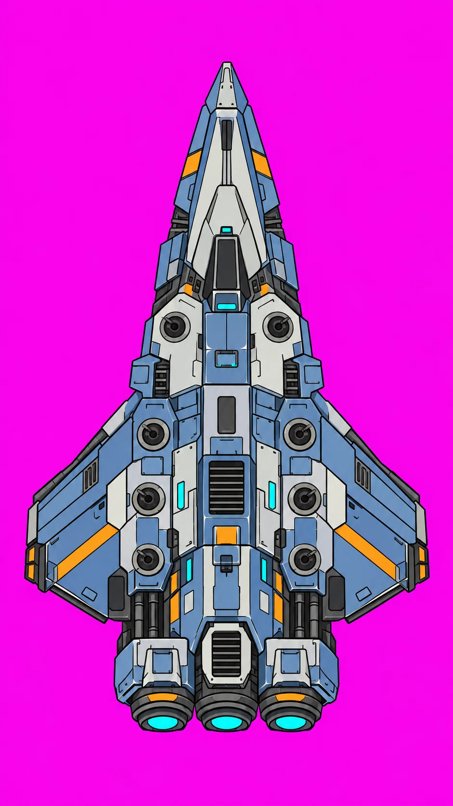
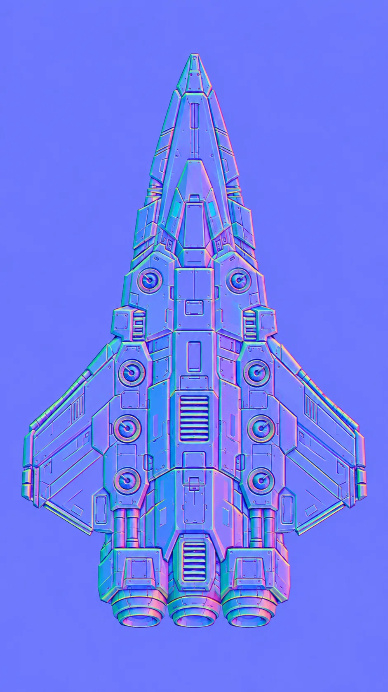
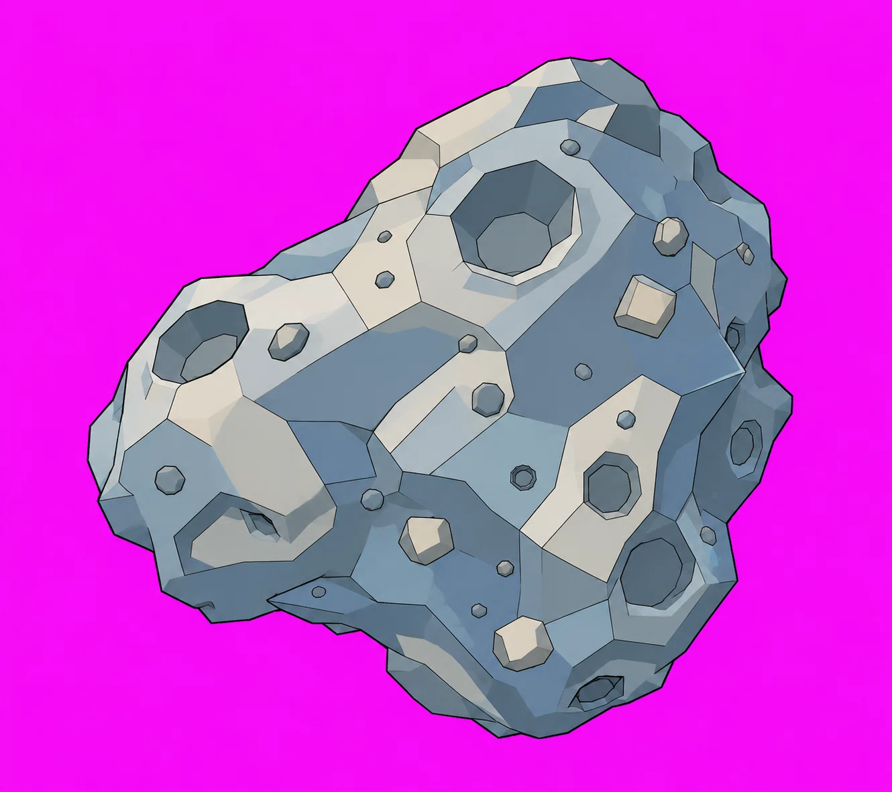
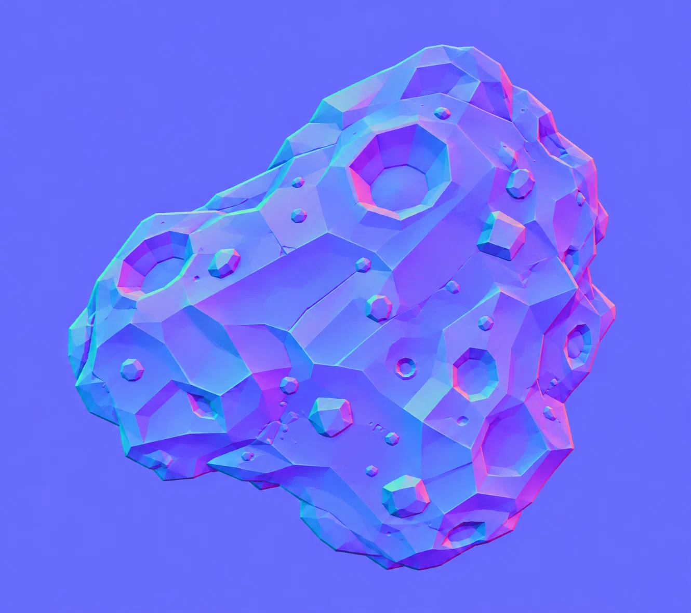
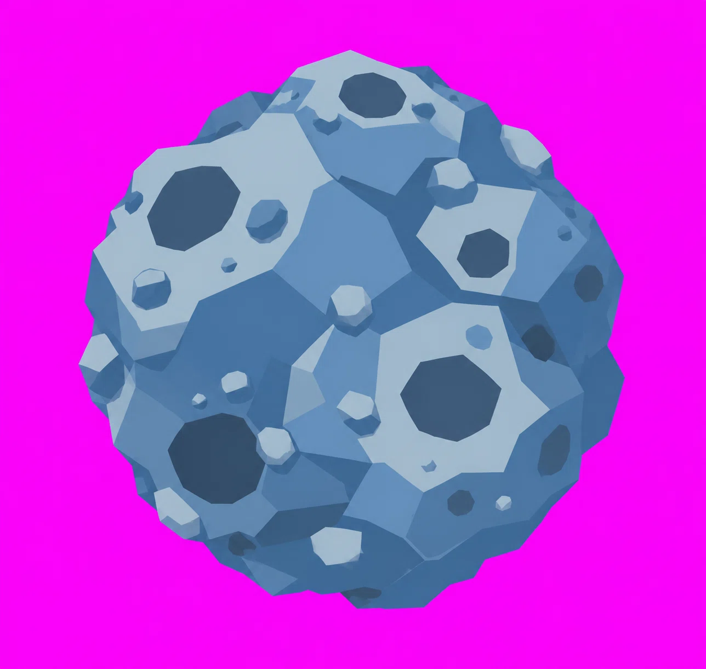
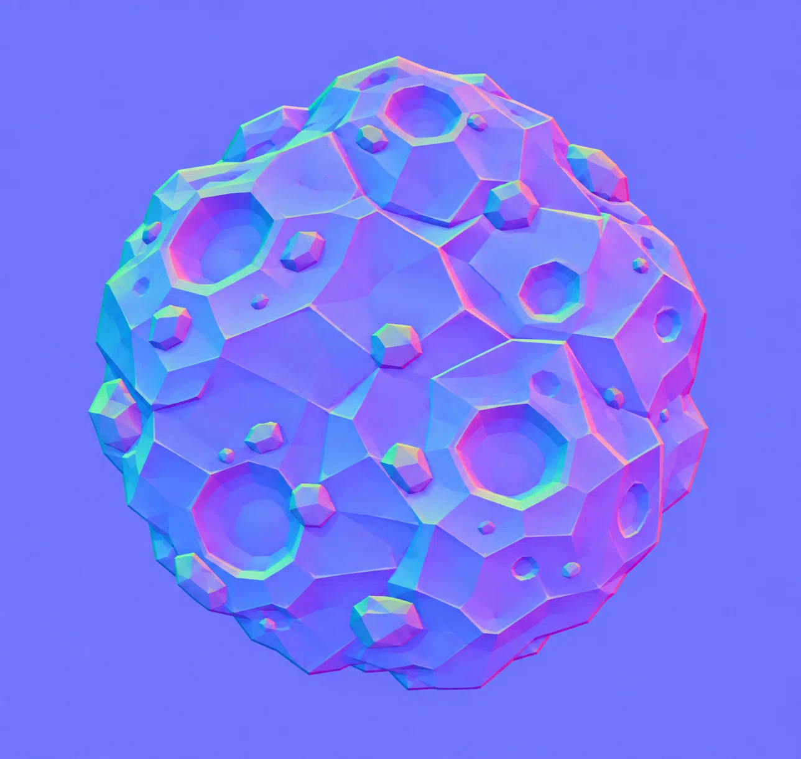

# Reference art

Source art for the 2.5D flying game. These files are **references/source assets, not runtime
textures yet**. The color images use a magenta chroma-key background; each has a companion
tangent-space normal map for 2.5D lighting.

## Ship

Top-down fighter, 941 × 1672 px.

<table>
  <tr>
    <td></td>
    <td></td>
  </tr>
  <tr>
    <td align="center"><code>ship-color.webp</code></td>
    <td align="center"><code>ship-normal.webp</code></td>
  </tr>
</table>

## Asteroid

1330 × 1182 px.

<table>
  <tr>
    <td></td>
    <td></td>
  </tr>
  <tr>
    <td align="center"><code>asteroid-color.webp</code></td>
    <td align="center"><code>asteroid-normal.webp</code></td>
  </tr>
</table>

## Asteroid, second variant

1288 × 1221 px — a rounder rock, supplied with the same colour/normal pairing. Processed to
`public/assets/lighting/asteroid2-*.png` with the identical one-off treatment and used for the
second rock in the world field.

<table>
  <tr>
    <td></td>
    <td></td>
  </tr>
  <tr>
    <td align="center"><code>asteroid2-color.webp</code></td>
    <td align="center"><code>asteroid2-normal.webp</code></td>
  </tr>
</table>

## Notes for future use

- Key out the magenta background before generating runtime sprites.
- These normal maps are lossy WebP references; re-export lossless PNG (or compressed KTX2) if
  they are used for real-time lighting.
- Keep source art in `docs/reference/`; processed runtime variants live in
  [`public/assets/lighting/`](../public/assets/lighting/) (see its README for the one-off
  matte/despill/resample steps).
- Ship color and normal maps share the same framing (941 × 1672), as do the asteroid pair
  (1330 × 1182), so they can be layered directly.
- The runtime ship art is mirrored across the vertical centerline for symmetry; the source
  reference above stays untouched.

- `turret.svg` is the supplied mounted-gun SVG, rasterized to
  `public/assets/lighting/turret.png` for the eight turret sprites.
